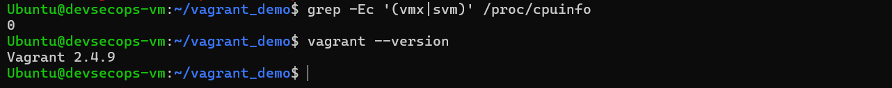
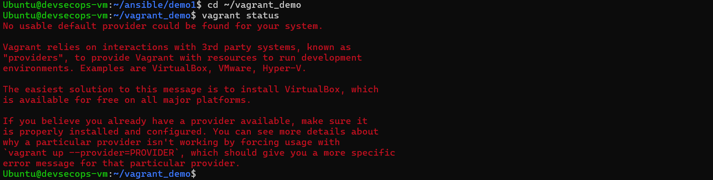
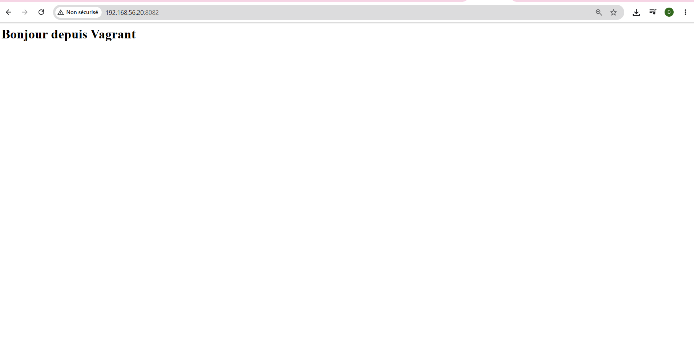
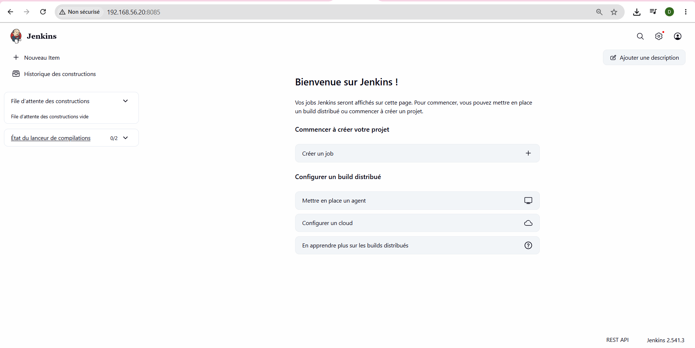

# 🚀 TP5 — Environnements de lab reproductibles avec Vagrant

**Étudiante :** Narjess Dabbech — Master DevOps & Cloud (M2) — 2026

---

## 📑 Sommaire
1. [Objectifs](#1--objectifs)
2. [Environnement](#2--environnement)
3. [Note sur la virtualisation imbriquée](#3-️-note-sur-la-virtualisation-imbriquée)
4. [Projet Vagrant](#4--projet-vagrant)
5. [Déploiement avec Ansible (simulation)](#5-️-déploiement-avec-ansible-simulation)
6. [Captures d'écran](#6--captures-décran)

---

## 1. 🎯 Objectifs
- Préparer une VM de lab avec la virtualisation imbriquée (Hyper-V → VirtualBox).
- Utiliser les commandes essentielles de Vagrant.
- Écrire un `Vagrantfile` avec provisionnement, dossier synchronisé et redirection de port.
- Combiner Vagrant et Ansible pour monter un lab complet.

## 2. 💻 Environnement

| Élément | Valeur |
| :--- | :--- |
| **Hôte** | Windows (Hyper-V) |
| **VM de lab** | `devsecops-vm` (Ubuntu 22.04) |
| **Nœud géré** | `master-2` (Ubuntu 22.04) |

## 3. ⚠️ Note sur la virtualisation imbriquée

La virtualisation imbriquée (*nested virtualization*) n'est pas activée sur l'hôte Windows Hyper-V. Il n'a donc pas été possible d'exécuter `vagrant up` à l'intérieur de la VM de lab : Vagrant signale qu'aucun provider n'est disponible.

**Contournement :** au lieu de créer de nouvelles VM avec Vagrant, j'ai réutilisé les deux VM existantes :
- `devsecops-vm` comme contrôleur Ansible ;
- `master-2` comme nœud géré.

Le `Vagrantfile` a été rédigé conformément au TP mais **n'a pas été exécuté**. Le playbook `vagrant_demo.yml` reproduit la configuration que Vagrant aurait appliquée (installation d'Apache et déploiement du site web).

## 4. 📁 Projet Vagrant

Structure du projet `vagrant_demo/` :

```text
vagrant_demo/
├── Vagrantfile
├── vagrant_demo.yml
├── web/
│   └── index.html
├── captures/
└── README.md
```

Le `Vagrantfile` définit :
- la box `bento/ubuntu-24.04` ;
- un dossier synchronisé : `web/` ;
- une redirection de port : 80 (VM) → 8080 (hôte).

`web/index.html` est la page de test servie par le lab.

## 5. ⚙️ Déploiement avec Ansible (simulation)

Le playbook `vagrant_demo.yml` installe Apache sur `master-2` et déploie le site web sur le port **8081** (le port 80 est déjà utilisé par Coolify/Traefik).

**Exécution :**
```bash
ansible-playbook vagrant_demo.yml -K
```

**Vérification :**
```bash
curl http://192.168.56.20:8081
```

**Résultat attendu :**
```html
<h1>Bonjour depuis Vagrant</h1>
```

## 6. 📸 Captures d'écran

### 6.1 Virtualisation imbriquée et version de Vagrant


### 6.2 Statut de Vagrant (provider non disponible)


### 6.3 Démo Vagrant (site web sur le port 8081)


### 6.4 Services du lab (Jenkins, Portainer, Nginx)


---

## 👤 Auteur
**Narjess Dabbech** — Master DevOps & Cloud — 2026
GitHub : [@Narjess805](https://github.com/Narjess805)
